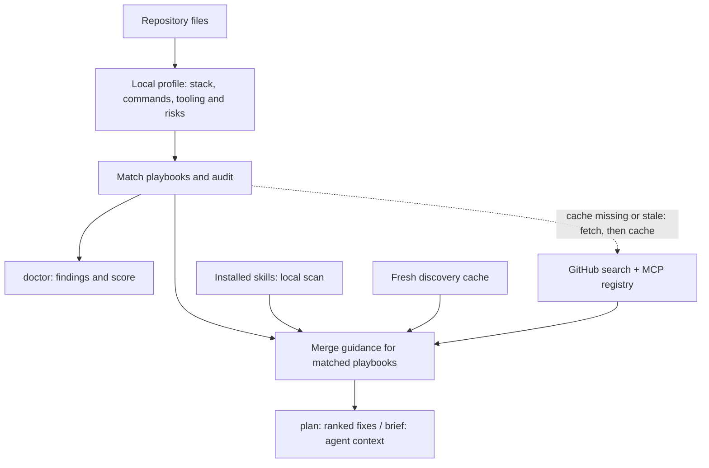

# anvil

An AI-ready dev harness. It audits a repository for AI-readiness, derives the agent context
from what it actually detects, and works tickets in parallel git worktrees.

The premise is narrow and falsifiable: an agent that cannot verify its own work produces
diffs nobody can review. So everything here is built around *evidence* — every command anvil
reports is backed by a file and a line number, and a rule that cannot prove its claim says so
rather than guessing.

## Install

Two channels are supported. Both install the same `anvil` binary, with no runtime dependencies.

### Prebuilt from npm

```bash
npm install -g @anvil-workflows/cli@0.2.1
```

or without installing, for one run:

```bash
npx @anvil-workflows/cli@0.2.1 doctor
```

The registry package is the prebuilt
[distribution plan](docs/adr/0012-versioned-prebuilt-distribution.md); its name is set by
[ADR-0023](docs/adr/0023-npm-package-name-is-anvil-workflows.md).

### From GitHub source

```bash
npm install -g github:tecruz/anvil
```

or for one run:

```bash
npx github:tecruz/anvil doctor
```

**Not `npm install -g anvil`.** That name belongs to an unrelated package on npm.

**Pin a tag if you care what you get.** A git install with no ref tracks the default branch,
so a breaking change reaches you on someone else's schedule — the same reason a lockfile
exists:

```bash
npm install -g github:tecruz/anvil#v0.2.1
```

Three things worth knowing:

- **The registry channel is prebuilt** and needs no build toolchain; the exact bytes are
  verified against a checksum and published with npm provenance.
- **The GitHub channel builds from source.** `dist/` is not committed, so npm runs the build
  during install. You need Node **22.18 or newer** — that is where running TypeScript directly
  (`node scripts/gen-playbooks.ts`, and the whole test suite) stopped needing a flag — and the
  first install takes a minute while it fetches the build toolchain.
- **The binary is one file with zero runtime dependencies**, so once installed it runs in a
  locked-down network with no further installs.

## What a finding looks like

Start with `anvil doctor` on a repository you know. Here is one real finding from this
repository, condensed from the full report:

| From the real report | What it means |
| --- | --- |
| `TEST_FAST` | The rule passed, with both claims found. |
| `test:changed` | The npm script behind the command, labelled `documented` and `detected`. |
| `README.md:172` | The line in this document that names the command. |
| `package.json:51` | The line that defines the script. |

Anvil reports both because a documented command that no longer runs is a defect and an
executable command nobody documented is invisible to an agent. When a finding is `fail` or `na`,
that same line is where you start: fix the document or the script, then run `npm run check`, which
is the command this repository declares as its verification and CI runs on every pull request.

## Use

```bash
anvil doctor            # audit this repository, with a score and the reasoning
anvil init              # derive AGENTS.md, a verify skill and a review command
anvil ready             # describe project needs; --check opts into environment probes
anvil setup plan        # review owner-declared setup commands; never execute or approve
anvil playbook check    # check the playbook registry for dead links
anvil playbook discover # find agent tooling the curated registry does not know yet
anvil mcp               # serve doctor, plan and crew status to an MCP client over stdio
```

Working a ticket is four commands: `anvil issue create`, `anvil claim` (branch, worktree and
the context an agent needs), `anvil crew verify`, `anvil ship`. Run `anvil --help` for the
rest, and add `--json` to anything for the versioned envelope the opencode plugin consumes.

Start with `anvil doctor` on a repository you know. If its findings are wrong, that is a bug
worth reporting - the tool was built by auditing twenty-seven real repositories, and the bugs
it found in itself are in [IMPLEMENTATION_PLAN.md](IMPLEMENTATION_PLAN.md) because they are
the interesting part.

**The [usage guide](docs/USAGE.md) is the manual**: what each command writes, how to
configure it, the environment variables, and the exit codes to script against.
[docs/ARCHITECTURE.md](docs/ARCHITECTURE.md) is for contributors: how the packages fit
together and where the state lives. The
[exact-candidate release evidence checklist](docs/RELEASE-EVIDENCE.md) defines what must exist
before a first publication can be reviewed; it is not approval to publish.

Inside opencode, the [plugin](packages/plugin-opencode/README.md) registers the same
tools for the agent, and keeps the ticket context alive when the conversation is
compacted.

## Local detection, online enrichment

Anvil detects the project from local files first, without running its build or calling a
model. Stack detection is entirely local; the network is used only to enrich the guidance
for the technologies already matched.



`plan` and `brief` read a fresh cache and fetch for only a technology whose cache is
missing or expired, so the first run after a clone searches and the following week is
answered from disk. `--offline` asks for no network at all, `--refresh` fetches even a
fresh cache, and `anvil playbook discover` is the same fetch driven directly. Discovery
never installs what it finds or edits the curated registry; it recommends resources,
ranked below the ones a human reviewed.

See the [offline and online command guide](docs/USAGE.md#offline-detection-and-online-discovery)
for the exact cache and flag behaviour.

## How it decides

- **Detection is evidence, not convention.** A command is reported because a file says so
  (`package-lock.json` means `npm ci`), and it is labelled `documented`, `detected` or
  `inferred` accordingly. A Go project gets no install command, because there is no install
  step.
- **"I don't know" is an answer.** A repository whose build system cannot be identified
  reports `na` and says why, rather than failing a blocker it has not earned.
- **Playbooks are executable configuration.** Their globs decide what counts as high risk and
  their verify commands are what a crew runs, so a playbook is validated before it is
  installed and never silently overwrites an existing one.
- **The curated registry stays curated.** `anvil playbook discover` fetches what a
  technology's own orgs have published since the last edit, caches it under `~/.anvil/`, and
  merges it into `plan` marked live and ranked below the entries a human reviewed. It never
  writes to `registry/playbooks/` — `--propose` prints the additions for a maintainer to
  merge.
- **Guidance has to earn its place.** The instruction file has a byte budget, and over it
  the commands have to be at the top: guidance an agent cannot infer from the repository is
  the part that pays for itself, and the rest is paid for on every request. A playbook
  resource can declare the files that mean the repository already follows it, and then the
  plan leaves it out and says how many it left out.
- **Cost is read, never recorded.** `anvil crew status --cost` prices the agent sessions
  with `ccusage`, which reads the usage logs already on the machine. anvil stores no usage
  data, uploads nothing, and a machine without ccusage still gets a complete report.

## Development

```bash
npm ci                  # install, and build the bundle (prepare runs on install)
npm run check           # lint, typecheck, the suite, the build, docs, and the eval gate
npm run test:changed    # only the packages your change affects, and their dependents
npm run setup:hooks     # once per clone: enable the pre-commit hook
```

`npm run check` is exactly what CI runs, on Windows, Linux and macOS, and a `CI_PARITY` rule
exists to catch the day those two stop agreeing. The docs check is part of it on purpose:
a document that names a command which does not exist, or a script the manifest does not
have, fails the build.

Architectural decisions are recorded in [docs/adr](docs/adr), the module map is in
[docs/ARCHITECTURE.md](docs/ARCHITECTURE.md), and [CONTRIBUTING.md](CONTRIBUTING.md) has
the conventions.

## What can be claimed

Anvil derives verified, evidence-linked agent context from a repository without calling a
model. Against four ground-truth cards fixed in advance, its offline output named the
correct verify command with a file-and-line citation in three of four cases; on the fourth,
a genuinely blocked repository, it reported `blocked` instead of inventing a command. Applied
to its own repository it scores 100 (A). The installed binary is a single dependency-free
file, and CI runs the same check on Windows, macOS and Linux. The scope, method and limits
are recorded in [the launch claim](docs/evidence/2026-11-25-launch-claim.md).

What is **not** claimed: that an agent using anvil completes tasks faster or more reliably.
Two predeclared paired pilots did not meet their threshold, and their results were not pooled
into a verdict — see [the nested pilot](docs/evidence/2026-11-25-nested-verification-pilot.md)
and [the powered pilot](docs/evidence/2026-11-25-powered-pilot-results.md). Anvil does not
yet diagnose arbitrary real blockers; that needs a declared `anvil.config.json`.

## Status

Pre-1.0, and honest about it. The command surface may change; the install instructions above
are the supported path. Security reports go through GitHub's private vulnerability reporting
for this repository - the address and the fallback are in [SECURITY.md](SECURITY.md) - read
it before reporting, because it also says what is out of scope.

MIT licensed. See [LICENSE](LICENSE).
